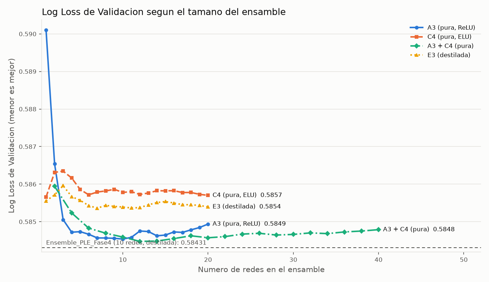

# Entrega 2: técnicas para reducir la Log Loss de la red neuronal

## 1. Pregunta de investigación e hipótesis

**Pregunta.** ¿Qué técnicas de deep learning tabular reducen la Binary Cross-Entropy (Log Loss) de nuestra MLP
de riesgo crediticio frente al mejor modelo de la Fase 4, manteniendo intacto el protocolo
Train/Validación/Test?

**Hipótesis de partida.** El diagnóstico de la Fase 4 atribuyó la pérdida de la red original a dos causas:
(a) formas no lineales univariadas mal modeladas, que la codificación PLE resolvió en gran parte; y
(b) interacciones de a pares difusas. La ganancia que daba ensamblar semillas sugería además una
**varianza alta entre semillas**. Las hipótesis H1-H9 (sección 5) atacan esas tres fuentes: representación,
optimización/regularización y varianza.

**Resultado en una frase.** Ninguna técnica nueva superó al mejor modelo de la Fase 4 en Validación. Sí se
obtuvo una **red 100% neuronal, sin profesor externo, que iguala al modelo destilado de Fase 4** (diferencia
en Test −0.00025, IC 95% [−0.00074, +0.00024]). Hay además evidencia negativa sólida sobre siete familias de técnicas.

## 2. Estado inicial y protocolo

| Elemento | Valor verificado en el repositorio |
| :--- | :--- |
| Datos | `DatasetCreditoFinancieroFinalV2.csv`, 49,650 filas; target `APTO_PARA_CREDITO` (50/50) |
| Columnas excluidas | `id_solicitud` y `INCUMPLIO_PAGO` (complemento exacto del target: fuga). Verificado por pruebas automáticas |
| Partición | Estratificada 70/15/15, semilla 42: 34,755 / 7,447 / 7,448. `load_raw()` la reconstruye y la contrasta con `artifacts/splits.npz` |
| Baseline | `Ensemble_Top3_Diverso`: Log Loss Val 0.58885, Test 0.59631 |
| Mejor modelo previo | `Ensemble_PLE_Fase4` (A3 ×5 + E3 ×5, E3 destilada desde LightGBM): Log Loss Val **0.58431**, Test 0.59293 |
| Referencia de experimentos | A3 de Fase 4 re-entrenada (`R0_A3_ref`): reproduce **exactamente** el 0.58505 de Fase 4 (entrenamiento determinista) |

**Reglas aplicadas.**
* Todo ajuste (cuantiles, árboles de tramos, escalado, profesor OOF) usa solo Train.
* La selección se hizo solo en Validación. Las predicciones de Test no se guardaron ni se examinaron durante la experimentación.
* La regla de selección final se fijó por escrito **antes** de ver los resultados del bloque S
  ([entrega2_preregistro.md](entrega2_preregistro.md), commit `76acbd2`).
* Métrica primaria: Log Loss sobre probabilidades con *clipping* en [1e-7, 1−1e-7] (`phase4_common.metrics`).
  Métricas secundarias: AUC y Brier.
* Comparaciones: diferencia absoluta de Log Loss y **bootstrap pareado** (2000 remuestreos de las mismas
  filas, `phase4_common.paired_bootstrap`), más la consistencia del efecto entre semillas.
* Cada experimento usa las semillas 42, 1 y 7 (las mismas de la referencia), con un solo factor cambiado
  respecto de A3: `[64, 32, 16]` ReLU, dropout 0.15, Adam 5e-4, batch 128, PLE de 16 tramos.

## 3. Revisión bibliográfica y priorización

Todas las referencias se verificaron en arXiv (título, autores y año). La columna "Aplicabilidad"
relaciona cada técnica con el diagnóstico de Fase 4.

| Línea | Técnica | Mecanismo / evidencia | Aplicabilidad a nuestro caso | Coste (CPU 4 núcleos) | Decisión |
| :--- | :--- | :--- | :--- | :--- | :--- |
| Representación | PLE por cuantiles y **PLE con tramos guiados por el target** [1] | Codificación lineal a trozos. Los tramos-árbol salen de un árbol de decisión por variable. Los autores muestran mejoras en MLP | PLE ya fue la mayor mejora de Fase 4; faltaba probar el número de tramos y los tramos-árbol | Bajo | **Ejecutado** (R1-R3) |
| Representación | **Embeddings periódicos PLR** [1], inspirados en Fourier features [2] | sin/cos con frecuencias entrenables, luego Linear + ReLU por variable. σ es sensible | Alternativa a PLE para relaciones no monótonas (`tasa_interes_ea`) | Bajo-medio | **Ejecutado** (R5-R6, dos valores de σ) |
| Representación | Datos ausentes | Fase 4 imputaba mediana + indicador | El bloque PLE codificaba la mediana imputada como si fuera un dato real | Bajo | **Ejecutado** (R4) |
| Arquitectura | **ResNet tabular** [3] | Bloques residuales con normalización. Línea base fuerte en [3] | Prueba si la profundidad residual capta mejor las interacciones | Bajo-medio | **Ejecutado** (K1, LayerNorm [11]) |
| Arquitectura | FT-Transformer [3], TabTransformer [4], TabNet [5] | Atención entre variables | [3] y [6] indican que las MLP bien ajustadas son competitivas; en [7], TabNet queda por debajo de XGBoost en datos ajenos a su artículo. Con 23 variables y CPU, el coste por época es mucho mayor | Alto | No ejecutado (coste/beneficio); pendiente |
| Arquitectura | TabM / BatchEnsemble [6], [8] | Ensamble eficiente de MLP con parámetros compartidos | El beneficio de fondo es reducir varianza, igual que un deep ensemble [9] | Medio | Se evaluó su principio con deep ensembles (bloque S). TabM queda pendiente |
| Arquitectura | DCN-v2 [10] | Capas cross para interacciones | Empeoró en Fase 4 (0.591-0.599) y no hay una hipótesis nueva | — | Descartado |
| Optimización | **AdamW** [12] | Weight decay desacoplado | Aislar su efecto sobre A3 (en Fase 4 iba mezclado con más dropout) | Bajo | **Ejecutado** (O4) |
| Optimización | **EMA / promedio de pesos** (cf. SWA [13]) | Promediar pesos lleva a óptimos más anchos | A3 se detiene en ~12 épocas con alta varianza: la EMA puede estabilizar el punto de parada | Bajo | **Ejecutado** (O1-O2) |
| Optimización | LayerNorm [11] | Normalización por muestra | BatchNorm empeoró en Fase 1; LayerNorm no depende del tamaño de batch | Bajo | **Ejecutado** (O3) |
| Optimización | SGDR / snapshot ensembles [14], [15] | Reinicios del LR y ensamble de instantáneas | Subsumido por el ensamble de semillas, que es más diverso | Medio | Pendiente |
| Optimización | SAM [16] | Busca mínimos planos; duplica el coste por paso | Sin evidencia específica en tabular de este tamaño | Medio-alto | Pendiente |
| Pérdida / calibración | **Temperature scaling** [17], calibración logística (Platt) | Recalibrar las probabilidades con 1-2 parámetros | Puede bajar la Log Loss sin cambiar el ranking. Hay que medirlo con **ajuste cruzado** para no confundirlo con sobreajuste a Validación | Mínimo | **Ejecutado** (post hoc) |
| Pérdida | Label smoothing [18] | Suaviza las etiquetas | [18] muestra que puede mejorar la calibración (ECE) pero perjudica la destilación. Los autores de RealMLP [19] advierten que la CE con label smoothing **no es una regla de puntuación propia** y no evalúan Log Loss. Nuestras redes ya salen calibradas (T≈0.95-0.97, sección 5.2) | — | No ejecutado: no hay hipótesis válida para minimizar la Log Loss |
| Ensamble | **Deep ensembles** [9]; promedio de probabilidades frente a logits; pesos | Reducción de varianza por inicializaciones distintas | La ganancia de ensamblar 3 semillas (≈0.003) sugería alta varianza | Lineal en el número de redes | **Ejecutado** (S1-S3 y post hoc) |
| Destilación | Knowledge distillation [20] | Etiquetas suaves de un profesor | Ya usada en E3 (Fase 4). Aquí se separa del resultado puro | Medio | Vía híbrida reportada aparte (S3) |
| Recetas | Regularization cocktails [21], RealMLP [19] | Combinaciones de regularizadores bien ajustados | Inspiran O1-O4. Una receta completa necesita una búsqueda de hiperparámetros mayor que el presupuesto | Alto | Componentes individuales ejecutados |

Contexto general: [7] y [22] documentan que los árboles con boosting suelen superar al deep learning en
datos tabulares medianos. Esto coincide con la referencia LightGBM de Fase 4 (Log Loss Test 0.58894) y
acota las expectativas.

## 4. Matriz priorizada de experimentos

Orden: de lo barato y aislable a lo costoso. Criterio de aceptación para cada técnica: Log Loss del
ensamble de 3 semillas **menor que la referencia R0** (0.58505), con efecto consistente entre semillas.
Se descarta si ΔLL ≥ 0. Se califica de **robusta** solo si además el IC 95% excluye 0.

| ID | Hipótesis | Archivo / componente | Configuración | Coste aprox. |
| :--- | :--- | :--- | :--- | :--- |
| PH | Calibración y pesos post hoc bajan la LL sin re-entrenar | `entrega2_posthoc.py` | T-scaling, Platt, logits, pesos; 10-fold dentro de Val | segundos |
| R1-R2 (H1) | 12 o 24 tramos superan a 16 | `Encoder(kind="ple", n_bins)` | A3 + n_bins | ~1 min por experimento |
| R3 (H2) | Tramos guiados por el target superan a los cuantiles | `Encoder(kind="ple_tree")` | árbol por variable, ≤16 hojas, ≥500 obs./hoja | ~1 min |
| R4 (H3) | No codificar la mediana imputada en PLE | `Encoder(nan_zero=True)` | A3 | ~1 min |
| R5-R6 (H4) | PLR sustituye con ventaja a PLE | `PeriodicEmbedding` | k=16, d=16, σ ∈ {0.05, 0.3}, entrada base 44 | ~2 min |
| O1-O2 (H5) | EMA de pesos reduce la varianza | `WeightEMA` | β=0.9 cada 64 pasos; lr 5e-4 y 2e-4 | ~1.5 min |
| O3 (H6) | LayerNorm estabiliza el entrenamiento | `train_mlp(layernorm=True)` | A3 | ~1.5 min |
| O4 (H7) | Weight decay aislado mejora | AdamW | wd 3e-2 | ~1 min |
| K1 (H8) | ResNet tabular mejora a la MLP | `train_mlp(resnet=...)` | d=64, 2 bloques, d_hidden=128 | ~1.5 min |
| S1-S3 (H9) | Más semillas reducen la LL (deep ensembles) | `entrega2_run.py --block S` | 20 semillas fijadas de antemano | 6-11 min por familia |

## 5. Resultados completos (Validación)

Fuente: [entrega2_resultados.csv](entrega2_resultados.csv) (115 filas: 96 redes individuales,
15 ensambles y 4 filas finales). Cada fila individual registra semilla, mejor época, épocas entrenadas,
duración, Log Loss de Train y Validación, AUC y Brier.

### 5.1 Técnicas aisladas (ensamble de 3 semillas frente a R0)

ΔLL > 0 significa que empeora. "Semillas que mejoran" compara cada semilla con la misma semilla de R0.

| Exp. | Técnica | LL Train | **LL Val** | LL media por semilla ± sd | AUC Val | Brier Val | ΔLL vs R0 [IC 95%] | Semillas que mejoran | Veredicto |
| :--- | :--- | :---: | :---: | :---: | :---: | :---: | :---: | :---: | :--- |
| R0 | Referencia A3 (PLE16) | 0.56757 | **0.58505** | 0.58823 ± 0.00133 | 0.75717 | 0.20030 | — | — | referencia |
| R1 | PLE 12 tramos | 0.57226 | 0.58707 | 0.58959 ± 0.00062 | 0.75511 | 0.20110 | +0.00202 [+0.00044, +0.00359] | 1/3 | empeora (robusto) |
| R2 | PLE 24 tramos | 0.56925 | 0.58646 | 0.58952 ± 0.00060 | 0.75585 | 0.20080 | +0.00141 [−0.00011, +0.00301] | 1/3 | descartada |
| R3 | PLE tramos-árbol | 0.57019 | 0.58638 | 0.58917 ± 0.00107 | 0.75555 | 0.20089 | +0.00133 [−0.00032, +0.00300] | 1/3 | descartada |
| R4 | PLE sin codificar la mediana imputada | 0.56916 | 0.58569 | 0.58839 ± 0.00081 | 0.75633 | 0.20059 | +0.00063 [−0.00054, +0.00180] | 1/3 | descartada |
| R5 | PLR σ=0.05 (sin PLE) | 0.57669 | 0.58806 | 0.59029 ± 0.00040 | 0.75446 | 0.20143 | +0.00300 [+0.00063, +0.00531] | 1/3 | empeora (robusto) |
| R6 | PLR σ=0.3 (sin PLE) | 0.57442 | 0.58751 | 0.58956 ± 0.00033 | 0.75450 | 0.20129 | +0.00246 [−0.00010, +0.00484] | 1/3 | descartada |
| O1 | EMA de pesos β=0.9 | 0.57037 | 0.58577 | **0.58779** ± 0.00121 | 0.75692 | 0.20053 | +0.00071 [−0.00002, +0.00145] | **3/3** | mejora cada red, no el ensamble |
| O2 | EMA + lr 2e-4 | 0.56873 | 0.58610 | 0.58857 ± 0.00128 | 0.75621 | 0.20069 | +0.00105 [−0.00001, +0.00217] | 2/3 | descartada |
| O3 | LayerNorm | 0.57199 | 0.58741 | 0.59049 ± 0.00047 | 0.75603 | 0.20116 | +0.00235 [+0.00053, +0.00420] | 0/3 | empeora (robusto) |
| O4 | AdamW wd 3e-2 | 0.57163 | 0.58571 | 0.58822 ± 0.00112 | 0.75649 | 0.20060 | +0.00066 [−0.00037, +0.00167] | 2/3 | descartada |
| K1 | ResNet tabular + LayerNorm | 0.57597 | 0.58591 | 0.58865 ± 0.00037 | 0.75641 | 0.20065 | +0.00086 [−0.00097, +0.00277] | 1/3 | descartada |

Media de épocas óptimas: entre 9 y 16 en todos los casos (K1: 5; O2: 21), con parada temprana a las 15 épocas sin mejora.

### 5.2 Técnicas post hoc (sin re-entrenar)

Fuente: [entrega2_posthoc.csv](entrega2_posthoc.csv). "In-sample" ajusta y evalúa en las mismas filas
de Validación. "Ajuste cruzado" ajusta en 9/10 de Validación y evalúa en el décimo restante.

| Conjunto | Técnica | LL Val | ΔLL [IC 95%] |
| :--- | :--- | :---: | :---: |
| A3 ×3 | Temperature scaling, in-sample (T=0.951) | 0.58485 | −0.00020 [−0.00065, +0.00027] |
| A3 ×3 | **Temperature scaling, ajuste cruzado** | 0.58508 | +0.00002 [−0.00043, +0.00050] |
| A3 ×3 | Platt, ajuste cruzado | 0.58509 | +0.00004 [−0.00043, +0.00052] |
| A3+C4 ×6 | Temperature scaling, ajuste cruzado | 0.58499 | +0.00016 [−0.00014, +0.00048] |
| A3+C4 ×6 | Platt, ajuste cruzado | 0.58501 | +0.00018 [−0.00015, +0.00051] |
| A3+C4 (familias) | Pesos optimizados, ajuste cruzado (frente a pesos iguales) | 0.58496 | +0.00014 [−0.00024, +0.00050] |
| A3 ×3 / A3+C4 / A3+E3 | Promedio de logits frente a probabilidades | — | entre −0.00002 y +0.00001 |

Lectura: el temperature scaling **parece** mejorar 0.0002 in-sample, pero esa mejora desaparece con
ajuste cruzado. Las redes entrenadas con parada temprana sobre la Log Loss ya salen calibradas (T≈0.95-0.97).
Es justo la distinción entre una mejora real y una "simple transformación de probabilidades sobreajustada a Validación".

### 5.3 Reducción de varianza: ensambles de 20 semillas (H9)



Datos del gráfico: [entrega2_curva_semillas.csv](entrega2_curva_semillas.csv).

| Exp. | Vía | Redes | LL Val ensamble | LL media por semilla ± sd | AUC Val | Brier Val |
| :--- | :--- | :---: | :---: | :---: | :---: | :---: |
| S1 A3 ×20 | pura | 20 | 0.58494 | 0.58910 ± 0.00093 | 0.75774 | 0.20017 |
| S2 C4 ×20 | pura | 20 | 0.58570 | 0.58629 ± 0.00065 | 0.75683 | 0.20048 |
| A3 ×20 + C4 ×20 | pura | 40 | **0.58479** | — | 0.75773 | 0.20010 |
| S3 E3 ×20 | destilada | 20 | 0.58540 | 0.58570 ± 0.00057 | 0.75723 | 0.20034 |
| A3 ×20 + E3 ×20 | híbrida | 40 | 0.58451 | — | 0.75814 | 0.19998 |

Hallazgos:
1. **El ensamble se satura pronto.** A3 pasa de 0.58505 (3 redes) a 0.58494 (20 redes); casi toda la
   ganancia ocurre antes de ~6-10 redes.
2. **"Maldición del ganador".** Las semillas 42, 1 y 7, con las que se eligió A3 en Fase 4, resultaron
   favorables: la media por semilla es 0.58823 con esas 3 y 0.58910 con 20. La referencia de 3 semillas es
   por tanto algo optimista y penaliza ligeramente las comparaciones de 5.1.
3. **Precisión individual frente a diversidad.** C4 (más regularizada) es mejor red individual que A3
   (0.58629 frente a 0.58910), pero su ensamble mejora poco (0.58570) porque sus semillas están más
   correlacionadas. Es el mismo patrón que O1 (EMA): la regularización reduce la varianza individual y también la diversidad.
4. Combinar familias puras (A3 + C4) da la menor Log Loss sin profesor externo: 0.58479.

## 6. Selección y evaluación final

**Regla pre-registrada** ([entrega2_preregistro.md](entrega2_preregistro.md)): el candidato puro es el de
menor Log Loss de Validación entre A3 ×20, C4 ×20 y A3 ×20 + C4 ×20. Se recomienda como modelo principal
si su Log Loss de Validación es menor que 0.58431, y se evalúa en Test una sola vez.

* Elegido: **`Ensemble_PLE_Puro_E2` = A3 ×20 + C4 ×20** (40 redes, LL Val 0.58479).
* Frente a `Ensemble_PLE_Fase4` en Validación: ΔLL = +0.00048, IC 95% [−0.00000, +0.00094]. **No cumple**
  la condición de ser menor que 0.58431, así que, según la regla, `Ensemble_PLE_Fase4` sigue siendo el mejor modelo registrado.
* Re-entrenamiento: las 40 redes reproducen **exactamente** las predicciones de Validación del bloque S
  (verificado con `assert`).

### Test (una sola evaluación del candidato puro)

Fuente: [entrega2_final_test.csv](entrega2_final_test.csv). Las filas del baseline y de Fase 4 reutilizan
predicciones calculadas en la Fase 4; esos modelos no se re-evaluaron.

| Modelo | Vía | Redes | LL Val | **LL Test** | AUC Test | Brier Test | Accuracy Test | ΔLL Test vs baseline [IC 95%] | ΔLL Test vs Fase 4 [IC 95%] |
| :--- | :--- | :---: | :---: | :---: | :---: | :---: | :---: | :---: | :---: |
| Baseline `Ensemble_Top3_Diverso` | red | 3 | 0.58885 | 0.59631 | 0.74482 | 0.20503 | 67.48% | — | — |
| `Ensemble_PLE_Fase4` | red + destilación | 10 | **0.58431** | 0.59293 | 0.74842 | 0.20363 | 68.22% | −0.00338 [−0.00593, −0.00085] | — |
| **`Ensemble_PLE_Puro_E2`** | **red pura** | 40 | 0.58479 | **0.59268** | 0.74875 | 0.20351 | 68.41% | −0.00363 [−0.00609, −0.00124] | −0.00025 [−0.00074, +0.00024] |
| Híbrido E2 (A3 ×20 + E3 ×20) | red + destilación | 40 | 0.58451 | no evaluado | — | — | — | — | — |

**Interpretación.**
* Ambas redes de Fase 4/E2 mejoran al baseline de forma estadísticamente significativa en Test, aunque
  la magnitud práctica es modesta (≈0.0035 nats por observación).
* La red pura y la red destilada son **equivalentes**: la diferencia en Validación (+0.00048) y en Test
  (−0.00025) tienen signo opuesto y ambos IC tocan o incluyen 0. No se declara superioridad de ninguna.
* Consecuencia práctica: la destilación desde LightGBM **no es necesaria** para alcanzar este nivel de
  Log Loss. Si el requisito académico exige que todo el procedimiento sea deep learning,
  `Ensemble_PLE_Puro_E2` cumple ese requisito sin perder rendimiento.

**Estado de Test.** Test se usó en la Fase 4 (baseline, `Ensemble_PLE_Fase4`, LightGBM e híbrido) y ahora
una vez más para `Ensemble_PLE_Puro_E2`. Nunca se usó para seleccionar, pero ya no es una muestra virgen
para el proyecto, y comparar varios modelos sobre ella aumenta el riesgo de comparaciones múltiples. Por
eso el resultado de Test se presenta como confirmación, no como base de la selección.

## 7. Diferenciación de vías

| Vía | Qué incluye | Mejor resultado | ¿100% deep learning? |
| :--- | :--- | :--- | :--- |
| Neuronal pura | MLP + PLE + ensamble de semillas; ningún modelo externo | `Ensemble_PLE_Puro_E2`: Val 0.58479, Test 0.59268 | Sí |
| Destilación | MLP entrenada con etiquetas suaves de LightGBM (solo en entrenamiento) | `Ensemble_PLE_Fase4`: Val 0.58431, Test 0.59293 | La inferencia sí; el entrenamiento depende de un GBDT |
| Referencia híbrida / GBDT | LightGBM, o mezcla de red + LightGBM | LightGBM: Test 0.58894 (Fase 4) | No |

## 8. Configuración recomendada

1. **Mejor modelo registrado según la regla pre-registrada:** `Ensemble_PLE_Fase4` (Val 0.58431).
2. **Recomendación para la entrega académica (modelo 100% red neuronal):** `Ensemble_PLE_Puro_E2`.
   Es equivalente en Log Loss (Δ Val +0.00048, Δ Test −0.00025, ambos dentro del ruido) y no depende de LightGBM.
   * Entrada: 44 variables originales + PLE de 16 tramos por cuantiles de Train (268 columnas).
   * 20 redes A3: ReLU `[64, 32, 16]`, dropout 0.15, Adam 5e-4, batch 128.
   * 20 redes C4: ELU `[64, 32, 16]`, dropout 0.3, AdamW 5e-4 con wd 0.03, batch 512.
   * Parada temprana sobre la Log Loss real de Validación (paciencia 15) y ReduceLROnPlateau.
   * Promedio simple de probabilidades; umbral 0.5.
   * Artefactos: `artifacts/entrega2/final_manifest.json`, `encoder_entrega2.joblib`, `final_models/`.
   * Coste de inferencia: 40 redes frente a 10 de Fase 4. Como el ensamble se satura pronto, una versión de
     ~10-12 redes perdería poco; no se evaluó en Test para no añadir otra comparación.

## 9. Integración con la API y el frontend

No se modificaron `src/api.py` ni el frontend: siguen sirviendo `Ensemble_Top3_Diverso`. Comprobado:
* `src/predict.py --entrega2` carga el nuevo ensamble. Acepta el **mismo formato de entrada** (diccionario o
  CSV con las columnas originales) y devuelve **las mismas columnas** (`id_solicitud`, `probabilidad_apto`,
  `probabilidad_no_apto`, `resultado`). Lo verifica `tests/test_entrega2.py::test_predict_output_format`.

Cambios necesarios para sustituirlo en producción, que quedan como decisión del equipo:
1. En `src/api.py` (`get_artifacts`), cargar con `load_model_and_preprocessor(entrega2=True)`. Las
   variables de entrada de la API no cambian.
2. Actualizar los textos descriptivos del modelo en la respuesta de la API (nombre, tipo y pesos, hoy fijos a "Top-3 Diverso").
3. Medir la latencia de 40 redes por solicitud (no medida en esta entrega).

## 10. Limitaciones, coste y riesgos

* **Sobreajuste a Validación.** Se evaluaron 15 configuraciones, más el análisis post hoc, sobre la misma
  Validación de 7,447 filas. Mitigaciones: un factor por experimento, semillas emparejadas, IC por bootstrap,
  ajuste cruzado para todo lo post hoc y regla final pre-registrada. Aun así, las diferencias < 0.001 son del orden del ruido.
* **Pocas semillas en el cribado.** Con 3 semillas, la varianza entre semillas (sd ≈ 0.001) es comparable a
  muchos efectos. Una técnica descartada aquí podría dar una ganancia pequeña que no detectamos.
* **Partición única** (sin validación cruzada anidada), como en las fases previas.
* **Hiperparámetros no ajustados por técnica.** PLR, ResNet y EMA se probaron con 1-2 configuraciones
  razonables, no con una búsqueda. La evidencia negativa es "en esta configuración", no definitiva.
* **Coste computacional medido:** 96 redes individuales en 41.5 min de entrenamiento (CPU de 4 núcleos,
  Windows, TensorFlow 2.18.1 / Keras 3.15.1), más el re-entrenamiento final de 40 redes. Cada proceso
  añade ~2 min de importación de TensorFlow.
* **Nombre de la rama.** Se pidió `entrega 2`, pero Git no admite espacios en nombres de rama
  (`git check-ref-format` lo rechaza). Se usó `entrega-2`.

## 11. Pendientes

* FT-Transformer y TabM [6] con presupuesto de GPU, comparados con el mismo protocolo.
* Más semillas en el cribado (≥10) para las técnicas que quedaron cerca de la referencia (R4, O1, O4).
* SAM [16] y snapshot ensembles [15].
* Ensamble reducido (~10-12 redes) de la vía pura, para bajar el coste de inferencia.

## 12. Reproducción

```bash
.venv/Scripts/python.exe src/phase4_baseline_check.py                 # verifica splits y baseline
.venv/Scripts/python.exe src/entrega2_posthoc.py                      # calibracion y pesos (post hoc)
.venv/Scripts/python.exe src/entrega2_run.py --block R                # representacion (R0-R6)
.venv/Scripts/python.exe src/entrega2_run.py --block O                # optimizacion (O1-O4)
.venv/Scripts/python.exe src/entrega2_run.py --block K                # ResNet (K1)
.venv/Scripts/python.exe src/entrega2_run.py --block S --seeds 42,1,7,21,2026,3,11,13,17,19,23,29,31,37,41,43,47,53,59,61
.venv/Scripts/python.exe src/entrega2_final.py                        # seleccion pre-registrada + Test (una vez)
.venv/Scripts/python.exe docs/entrega2_charts.py                      # grafico de la curva de semillas
.venv/Scripts/python.exe -m pytest -q                                 # 14 pruebas
.venv/Scripts/python.exe src/predict.py --json data/ejemplo_solicitante.json --entrega2
```

S3 (E3 destilada) necesita `artifacts/phase4/teacher_oof_train.npy`, generado por
`src/phase4_teacher_oof.py` (ya versionado).

## Referencias

1. Gorishniy, Y., Rubachev, I., Babenko, A. (2022). *On Embeddings for Numerical Features in Tabular Deep Learning*. NeurIPS 2022. https://arxiv.org/abs/2203.05556
2. Tancik, M., et al. (2020). *Fourier Features Let Networks Learn High Frequency Functions in Low Dimensional Domains*. NeurIPS 2020. https://arxiv.org/abs/2006.10739
3. Gorishniy, Y., Rubachev, I., Khrulkov, V., Babenko, A. (2021). *Revisiting Deep Learning Models for Tabular Data*. NeurIPS 2021. https://arxiv.org/abs/2106.11959
4. Huang, X., Khetan, A., Cvitkovic, M., Karnin, Z. (2020). *TabTransformer: Tabular Data Modeling Using Contextual Embeddings*. https://arxiv.org/abs/2012.06678
5. Arik, S. Ö., Pfister, T. (2019). *TabNet: Attentive Interpretable Tabular Learning*. AAAI 2021. https://arxiv.org/abs/1908.07442
6. Gorishniy, Y., Kotelnikov, A., Babenko, A. (2024). *TabM: Advancing Tabular Deep Learning with Parameter-Efficient Ensembling*. https://arxiv.org/abs/2410.24210
7. Shwartz-Ziv, R., Armon, A. (2021). *Tabular Data: Deep Learning is Not All You Need*. https://arxiv.org/abs/2106.03253
8. Wen, Y., Tran, D., Ba, J. (2020). *BatchEnsemble: An Alternative Approach to Efficient Ensemble and Lifelong Learning*. ICLR 2020. https://arxiv.org/abs/2002.06715
9. Lakshminarayanan, B., Pritzel, A., Blundell, C. (2017). *Simple and Scalable Predictive Uncertainty Estimation using Deep Ensembles*. NeurIPS 2017. https://arxiv.org/abs/1612.01474
10. Wang, R., et al. (2021). *DCN V2: Improved Deep & Cross Network and Practical Lessons for Web-scale Learning to Rank Systems*. WWW 2021. https://arxiv.org/abs/2008.13535
11. Ba, J. L., Kiros, J. R., Hinton, G. E. (2016). *Layer Normalization*. https://arxiv.org/abs/1607.06450
12. Loshchilov, I., Hutter, F. (2019). *Decoupled Weight Decay Regularization*. ICLR 2019. https://arxiv.org/abs/1711.05101
13. Izmailov, P., et al. (2018). *Averaging Weights Leads to Wider Optima and Better Generalization*. UAI 2018. https://arxiv.org/abs/1803.05407
14. Loshchilov, I., Hutter, F. (2017). *SGDR: Stochastic Gradient Descent with Warm Restarts*. ICLR 2017. https://arxiv.org/abs/1608.03983
15. Huang, G., et al. (2017). *Snapshot Ensembles: Train 1, get M for free*. ICLR 2017. https://arxiv.org/abs/1704.00109
16. Foret, P., Kleiner, A., Mobahi, H., Neyshabur, B. (2021). *Sharpness-Aware Minimization for Efficiently Improving Generalization*. ICLR 2021. https://arxiv.org/abs/2010.01412
17. Guo, C., Pleiss, G., Sun, Y., Weinberger, K. Q. (2017). *On Calibration of Modern Neural Networks*. ICML 2017. https://arxiv.org/abs/1706.04599
18. Müller, R., Kornblith, S., Hinton, G. (2019). *When Does Label Smoothing Help?* NeurIPS 2019. https://arxiv.org/abs/1906.02629
19. Holzmüller, D., Grinsztajn, L., Steinwart, I. (2024). *Better by Default: Strong Pre-Tuned MLPs and Boosted Trees on Tabular Data*. NeurIPS 2024. https://arxiv.org/abs/2407.04491
20. Hinton, G., Vinyals, O., Dean, J. (2015). *Distilling the Knowledge in a Neural Network*. https://arxiv.org/abs/1503.02531
21. Kadra, A., Lindauer, M., Hutter, F., Grabocka, J. (2021). *Well-tuned Simple Nets Excel on Tabular Datasets*. NeurIPS 2021. https://arxiv.org/abs/2106.11189
22. Grinsztajn, L., Oyallon, E., Varoquaux, G. (2022). *Why do tree-based models still outperform deep learning on tabular data?* NeurIPS 2022 (Datasets and Benchmarks). https://arxiv.org/abs/2207.08815
